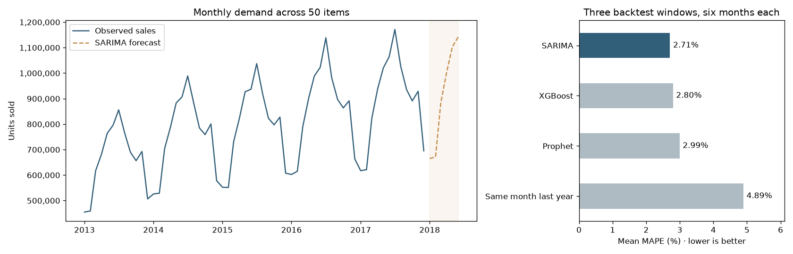

# Sales forecasting and demand planning

A six-month demand forecast for 50 products, with a seasonal baseline to check whether the extra modeling work pays off.

Across three backtest windows, **SARIMA averages 2.71% MAPE**, compared with **4.89%** for "same month last year." That is a 45% reduction in mean percentage error. The baseline still wins one of the three windows when growth slows, which is the most useful failure in this analysis.

This is a public-data rebuild of the forecasting approach I used as a Data Analyst at Think and Wash. Employer data is not included. The results here belong to the public dataset, not the projects' business outcomes on my resume.



Start with the [executed notebook](notebooks/eda.ipynb) for the seasonal patterns and growth slowdown, or inspect the [backtest results](results/backtest.csv) and [six-month forecast](results/forecast_next_6_months.csv) directly.

## Forecasting setup

Data comes from [Kaggle Store Item Demand Forecasting](https://www.kaggle.com/competitions/demand-forecasting-kernels-only/data): 913,000 daily records, 10 stores and 50 items from 2013 to 2017. Store sales are summed into **60 months × 50 items**. This forecasts total demand per item, not demand at each store.

The series are unusually regular and share a similar seasonal shape. These error rates should not be treated as an expectation for noisier business data. Download the dataset from Kaggle under its terms; source CSVs are not redistributed here.

| Model | Implementation |
|---|---|
| Seasonal naive | Reuse the corresponding month from the previous year. |
| SARIMA | Fit `(0,1,1)(0,1,1,12)` to log sales, separately for each item. |
| Prophet | Fit each item with multiplicative yearly seasonality; no weekly or daily terms. |
| XGBoost | Pool all items into one model using month, lagged sales and a trailing sales level. Scale targets and lags so large products do not dominate solely through volume. |

XGBoost's features use observations at least six months old. That lets it predict all six future months directly, without feeding predictions back as inputs. The same model interface is used in every backtest: history goes in, a six-month item-by-month forecast comes out.

## Backtest results

Three expanding training windows predict **July–December 2016**, **January–June 2017** and **July–December 2017**. Each fit uses only observations before its window. MAPE is calculated across six months for each item, then summarized over the 150 item/window combinations.

| Model | Mean MAPE | Median MAPE | Worst item/window |
|---|---:|---:|---:|
| **SARIMA** | **2.71%** | 1.44% | 7.81% |
| XGBoost | 2.80% | 2.81% | 6.12% |
| Prophet | 2.99% | 2.43% | 6.39% |
| Seasonal naive | 4.89% | 3.91% | 9.21% |

SARIMA beats the baseline on all 50 items when each item's errors are averaged over the three windows. XGBoost is close behind and has the lowest worst item/window error. It also requires one fitted model rather than 50.

### Where the baseline wins

| Test window | SARIMA | XGBoost | Prophet | Seasonal naive |
|---|---:|---:|---:|---:|
| Jul–Dec 2016 | 1.34% | 2.85% | 2.25% | 7.73% |
| Jan–Jun 2017 | 5.72% | 3.85% | 4.92% | **3.15%** |
| Jul–Dec 2017 | 1.06% | 1.70% | 1.81% | 3.80% |

Annual growth drops from 8.6% in 2016 to 3.6% in 2017. SARIMA carries too much of the earlier growth forward and over-forecasts each month in the first half of 2017 by roughly 4–7%. The no-growth assumption in the seasonal baseline happens to work better there.

The final January–June 2018 forecast is fitted on all available history using the model with the lowest average backtest MAPE. Those future actuals are unavailable in this dataset, so that forecast has no measured error here. The backtests select the model; they are not an untouched final test of that selection.

## Run locally

Tested with Python 3.12. From the repository root:

```bash
python3 -m venv .venv
source .venv/bin/activate
python -m pip install -r requirements.txt
python test_forecast.py
mkdir -p data
```

Download Kaggle's `train.csv` into `data/`, then run:

```bash
python forecast.py
```

This runs all four models through the backtest and writes:

- `results/backtest.csv`: each model, item and test window.
- `results/summary.csv`: mean, median and maximum MAPE.
- `results/forecast_next_6_months.csv`: monthly item forecasts for January–June 2018.
- `results/forecast.png`: history, forecast and model comparison.

The [tests](test_forecast.py) use synthetic data with known seasonality and trend. They check the baseline's exact answer on repeating seasons, forecast shapes and dates, and model behavior with trend. No source download is needed for those checks. Jupyter is optional and can be installed separately to rerun the notebook.

## What this leaves unresolved

There are no prediction intervals, promotions, prices, stockouts or external events in the models. MAPE also breaks on zero-demand months; use a different metric such as WAPE for a dataset containing those. Before a forecast guided purchasing or staffing, it would need interval estimates and monthly error monitoring. The 2017 slowdown is a concrete reason to track errors by period rather than relying on one average score.
